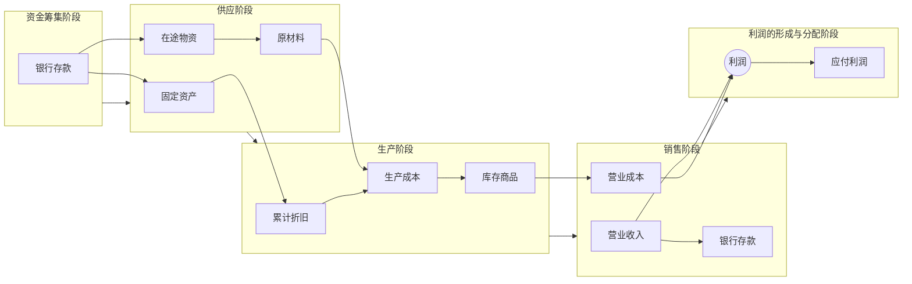

# 总论

## 会计的定义

> 会，会合、聚集之意；计，数数、计算之意。
>
> 零星算之为计，总合算之为会。

学术层面：

- **管理活动论**：会计是一种经济管理**活动**。事前预测、审查、综合分析、评价、参与经营决策、规划。
- **信息系统论**：会计是一个经济信息**系统**。将经济业务转换为会计信息，给出财务报告。

会计是以提高企业**经济效益**为目标，采用一系列的程序和方法，以**货币**为主要计量单位，**核算和监督**一个单位经济活动（投资、筹资、经营）的一项**经济管理工作**。会计在对企业的经济活动进行**核算和监督**（会计职能）的同时，为会计信息使用者提供决策所需的**财务信息**。

会计核心目标：**决策有用观**（相关性）、**受托责任观**（可靠性）。 基于资本市场的发展和股权分散的现实。

受托责任观：以企业的**所有权和经营权分离**为前提，认为财务报告的目标是向股东反映企业管理层受托责任的情况。

### 基本职责

- **核算**（最基本）：以货币为主要计量单位，对特定主体的经营活动进行**确认**（定性，是什么）、**计量**、**记录**和**报告**。
- **监督**：对**特定主体经济活动**和**相关会计核算**的真实性、完整性、合法性、合理性进行**审查**。
- 拓展职能：分析、预测、决策、考核。

### 会计假设

会计主体：会计为其服务的单位。

1. 划清单位与单位之间的界限

2. 划清公与私的界限

3. 会计主体≠法律主体

持续经营假设：只核算企业以当前的规模和状态继续经营下去。

会计分期假设：建立在持续经营假设基础之上，将企业持续经营活动的期间划分为若干长短相同的期间。

货币计量假设：货币币值本身会波动。会计采用某一货币作为记账本位币时，需要假设该货币的币值是稳定的。

### 会计原则

会计工作原则：真实、有用、规范、固定、合理（记录重要资产，省略不重要的经济业务）、重点。

会计核算原则：

1. **权责发生制**：以取得收取款项的权利和支付款项的义务为标志。

   > 两个凡是：凡是 当期已实现的收入 和 已经发生或应当承担的费用，无论款项是否收付，都应当作为当期的收入和费用，计入利润表；凡是不属于当期的收入和费用，即使款项在当期收付也不应当作为当期的收入和费用。

2. **收付实现制**：以实际收付现金作为确认收支的标准。

   > 我国：企业采用权责发生制；政府会计的财务会计采用权责发生制，预算会计采用收付实现制。

3. **收入费用配比原则**：在**收入确认**的情况下，将与之相关的费用寻找出来，与之配比计算当期损益。分为因果配比和期间配比。

4. **划分收益性、资本性支出原则**：

   1. 资本性支出（capital expenditure）：形成资产的货币性支出，与未来期间的收入相匹配。
   2. 费用性支出（或收益性支出，revenue expenditure）：形成费用的货币性支出，计入当期损益。

### 会计循环

定义：将企业经济信息转化为会计信息的会计程序。包括**证（填制、审核会计凭证）、账（登记会计账簿）、表（编制财务报表）**。

# 会计要素与会计等式

## 会计对象

定义：会计主体核算和监督的客体，具体表现为**企业的经济活动**。

> 工作流程：确认——计量——记录——报告
>
> 工作载体：凭证——账簿——报表
>
> 工作内涵：对象——要素——科目、账户

企业的经济活动分为**交易**（企业与其他单位）和**事项**（企业内部）。

## 会计要素

静态会计要素（时点类会计要素）：资产、负债、所有者权益。形成资产负债表。

动态会计要素（时期类会计要素）：收入、费用、利润。形成利润表。

**第一层级**：资产、负债、收入、费用；**第二层级**：所有者权益、利润。

### 资产

定义：由企业**过去的**交易和事项形成；为企业**拥有或控制**的资源；预期为企业**带来收益**。

分类：

1. 流动资产：货币资金、应收票据、应收账款、预付款项、交易性金融资产、其他应收款、存货等。
2. 非流动资产：长期应收款、长期股权投资、投资性房地产、固定资产、在建工程、无形资产、债权投资、其他债权投资、其他权益工具投资等。

### 负债

定义：由企业**过去的**交易和事项形成；是企业承担的**现时义务**；预期会导致企业**利益流出**。

> 现时义务与潜在义务相对。潜在义务例：借贷的担保，当借贷人无法及时还款时，担保人有义务向银行还款。

分类：

1. 流动负债：短期借款、应付票据、应付账款、预收账款、合同负债、应付职工薪酬、应交税费、其他应付款等。
2. 非流动负债：长期借款、应付债券、长期应付款等。

### 所有者权益

定义：企业资产扣除负债后，由所有者享有的剩余权益。又称为股东权益（净资产）。可以反映所有者投入资本的保值增值情况。

来源：

1. 所有者投入的资本：
   - 实收资本（股本）：构成企业注册资本的金额
   - 资本公积——资本溢价（股本溢价）
2. 留存收益：
   - 盈余公积：法定盈余公积、任意盈余公积
   - 利润分配——未分配利润
   - 其他综合收益

### 收入

定义：是企业在**日常活动**中形成的；与**所有者投入资本无关**的经济利益的总流入；会**导致所有者权益增加**。

> 广义的收入包括非日常的“利得”部分，如“营业外收入”。

区分：

1. 主营业务收入
2. 其他业务收入
3. 投资收益、公允价值变动损益、资产处置损益
4. 营业外收入

### 费用

定义：是企业在**日常活动**中形成的；与**所有者投入资本无关**的经济利益的总流出；会**导致所有者权益减少**。

> 广义的费用包括非日常的“损失”部分，如“营业外支出”。

区分：

1. 营业成本
   - 主营业务成本
   - 其他业务成本
2. 期间费用
   - 销售费用
   - 管理费用
   - 财务费用
3. 税金及附加：企业应负担的**部分**税费
4. 营业外支出
5. 所得税费用

> 支出：所有现金流出的业务。费用属于支出的一小部分。支出还包括成本以及偿还债务、支付税金等纯支出项。

### 利润

定义：企业在一定会计期间的经营成果。

收入-费用=负数，为**亏损**。

日常性收入-日常性费用=营业利润

营业利润+营业外收入-营业外支出=利润总额

利润总额-所得税费用=净利润

### 关系

资产-负债=所有者权益，收入-费用=利润

动态等式：△资产=△负债+所有者权益+利润

## 会计等式

**静态等式：资产=负债+所有者权益**，反映某一时点财务状况，是复式记账法的理论基础。**最终**等式会平衡。

**动态等式：利润=收入-费用**，反映某一期间的经营成果。

**综合等式：费用+资产=负债+所有者权益+收入**。期末结账前的任何时候都是平衡的。

## 会计确认

概念：将某一会计事项作为会计要素加以记录的过程。

- 初始确认：交易或事项发生时，按照会计要素的定义和确认条件

# 账户与复式记账

## 会计科目

定义：在**会计要素分类的基础**上，对**会计对象**所做的**进一步分类**。是会计要素的具体化。

> 主体 -> 对象 -> 要素 -> 科目。科目有明确所属的会计要素。

## 会计账户

根据**会计科目**设置，反映会计要素增减变动情况及其结果，又称“丁字账”。

### 记账规则

1. 左方叫借方，右方叫贷方（左借右贷）。

2. 资产/费用类：借方记录增加额，贷方记录减少额。（左加右减）

3. 负债、所有者权益/收入类：贷方记录增加额，借方记录减少额。（左减右加）

4. 任何账户的正常余额都在记录增加额的那一方。因此，资产类账户的余额在借方，负债和所有者权益类账户的余额在贷方。

> 这样设置的原因：会计恒等式。等号左边（资产）和等号右边（负债+所有者权益）记账规则相反。
>
> 收入是所有者权益的来源之一，所以记账规则相同。
>
> 利润可以通过收入和费用计算，所以记账时不考虑。

| 借方（银行存款）        | 贷方（银行存款）        |
| ----------------------- | ----------------------- |
| 期初余额 1,000.00       |                         |
| 记-001 销售收款 500.00  |                         |
|                         | 记-002 支付办公费 300.00 |
| **本期借方发生额 500.00** | **本期贷方发生额 300.00** |
| **期末余额 1,200.00**   |                         |

公式：**期末余额 = 期初余额 + 本期增加发生额 - 本期减少发生额**。

## 复式记账

单式记账：只在一个账户中加以登记；

复式记账：用相等的金额在两个或两个以上相互联系的账户中进行登记，全面系统地反映经济业务增减变化

复式记账分为增减记账法、收付记账法、**借贷记账法**。

### 会计分录

**三要素**：

1. 记账符号：表明记账方向，即借方或贷方

2. 会计科目

3. 金额

```
借：固定资产 6000
    贷：银行存款 3000
       库存现金 1000
       应付账款 2000
```

先写借后写贷，加冒号；分行写，错开一格；总金额要相等。

### 试算平衡

# 会计凭证

# 企业主要经济业务的核算

## 概述



## 筹资业务的核算

### 筹资方式

1. 股权融资（只关注本金）

   - 公开募集：向不特定人群或机构公开发行股票

   - 私下募集：向特定的人或机构以私下协商的方式出售股份

   - 记账：“贷：实收资本—国家/法人/个人/外商资本”

2. 债务筹资（关注本金和**利息**）

   - 借款：向银行等金融机构贷款

   - 发行债券

> 结算方式：票据。支票（10天），本票（2月，本地），汇票（6月，异地）
>
> 支票——银行存款、？
>
> 本票、汇票 —— XX票据 —承兑— 银行存款、？

### 供应阶段的核算

#### 固定资产的采购

定义：**超过一个会计年度**的，为生产、提供劳务、出租或经营管理而持有的**有形**资产。

1. 成本

   - 包含 所有的支出+增值税。

   - 增值税核算时不计入成本

   > 增值税：对增值额征税。
   >
   >     理论上：应交增值税额=增值额✕增值税税率
   >
   >     实务上：应交增值税额=销项税额-进项税额
   >
   > 会计科目：应交税费——应交增值税

2. 核算

   - 不安装：以**固定资产**核算。

     ```
     借: 固定资产-灭菌柜               400000
        应交税费-应交增值税（进项税额）   52000
        贷：银行存款                   452000
     ```

   - 安装：以**在建工程**核算。当看到“安装调试完成”，再以**固定资产**核算。

     ```
     借：在建工程-医用口罩生产线-成本         800000
               -N95口罩生产线-成本         1200000
        应交税费-应交增值税（进项税额）       260000
        贷：银行存款                       2260000
     ```

     ```
     借：在建工程-医用口罩生产线-安装         40000
               -N95口罩生产线-安装         80000
        应交税费-应交增值税（进项税额）       156000
        贷：银行存款                       135600
     ```

     ```
     借：固定资产-医用口罩生产线         840000
               -N95口罩生产线         1280000
        贷：固定资产-医用口罩生产线      840000
               -N95口罩生产线         1280000
     ```

#### 原材料的采购

1. 成本

   - 包含买价、税费、共同费用（运输、损耗等）

   - 共同费用分摊率=共同费用/（重量、体积、价格等）。原则：**公平**合理

2. 货款支付

   - 交货前支付：预付账款（定金）；交货后支付：应付账款。

     > Tips: 预付账款是资产类会计要素。

3. 结转（入库）

   - 没有出现“验收入库”时，以**在途物资**核算。入库后，结转为**原材料**。

     ```
     借：在途物资-熔喷布              900000
               -热风棉               60000
        应交税费-应交增值税（进项税额） 124800
        贷：银行存款                1084800
     ```

> 注：预付账款时，由于买卖双方权利义务没有建立，所以借方仅有预付账款，贷方仅有银行存款。
>
> ```
> 借：预付账款——昆山纺织　　　　100000
> 　　贷：银行存款　　　　　　　 100000
> ```
>
> 当物资运达、尾款支付后，才能记账为：
>
> ```
> 借：在途物资——亲肤布　　　　　       110 000
> 　　应交税费——应交增值税（进项税额）  14300
> 　　贷：银行存款　　　　　　　　　    24300
> 　　　　预付账款——昆山纺织　　　     100000
> ```
